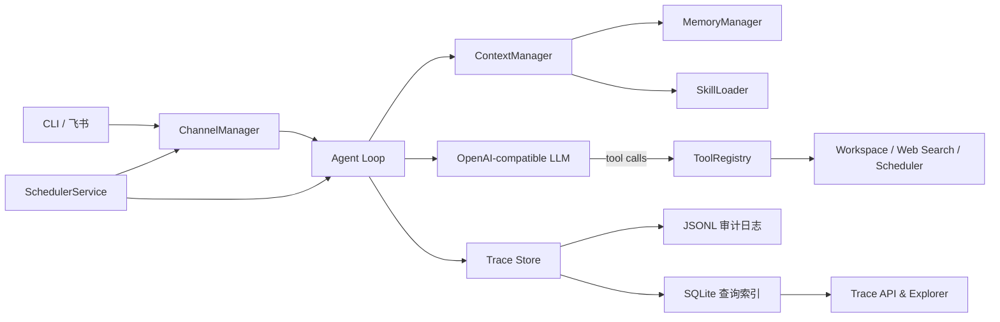

# my-agent

一个面向学习与工程实践的轻量级 AI Agent：支持多渠道对话、工具调用、长期记忆、定时任务，以及可查询的完整运行链路。

`my-agent` 不只是一个聊天 Demo。项目围绕 Agent 在真实运行中需要回答的几个问题展开：

- Agent 调用了什么工具，为什么失败？
- 多轮对话如何隔离、裁剪和沉淀为长期记忆？
- Agent 如何主动执行提醒或周期任务，并把结果送回原渠道？
- 文件和 Shell 工具如何限制在指定工作区内？
- 一次请求的 LLM、工具和渠道耗时如何被记录、查询和展示？

> 当前项目适合本地学习、原型验证和 Agent 工程能力演示，尚未实现完整的用户认证、RBAC、工具审批与分布式调度，不建议未经加固直接暴露在公网或用于生产环境。

## 功能概览

| 模块 | 能力 |
| --- | --- |
| Agent Loop | OpenAI-compatible 模型调用、多步工具执行、最大步数保护 |
| 多渠道接入 | CLI；飞书 WebSocket 长连接、私聊与群聊 `@Bot` 响应 |
| 上下文管理 | 按会话隔离上下文，超长对话自动裁剪 |
| 长期记忆 | 原始对话、情景记忆、语义记忆、SQLite FTS 检索、按需注入 |
| 记忆整理 | 异步生成 daily memory、每日 Dream 整理、工作流 SOP 提炼 |
| 内置工具 | Bash、文件读写与编辑、Glob、记忆、联网搜索、定时任务 |
| 主动任务 | 一次性提醒、固定间隔任务、Cron 任务，结果回送原渠道 |
| 可观测性 | Trace/Span、LLM 与工具耗时、Token 用量、错误信息、敏感字段脱敏 |
| Trace Explorer | 本地 Web 面板、历史筛选、Span 树、调试包、SQLite 索引修复 |
| 安全边界 | Workspace 路径约束、Shell 危险命令拦截、子进程环境变量白名单 |

## 工作原理



一次普通请求的主要链路如下：

```text
Channel 收到消息
  -> 为 session 创建 RunContext
  -> ContextManager 组装身份、记忆、技能和历史消息
  -> LLM 决定直接回复或调用工具
  -> ToolRegistry 在安全边界内执行工具
  -> Agent 继续推理，直到返回答案或达到 max_steps
  -> Channel 回复用户
  -> Trace 同时写入 JSONL 和 SQLite
```

同一会话内的消息串行执行，不同会话通过线程池并行处理，避免上下文串线。

## 快速开始

### 0. 运行配置文件位置

项目运行相关文件集中在根目录：

| 文件 | 作用 |
| --- | --- |
| `requirements.txt` | 运行依赖，包含飞书渠道和 Cron 调度所需包 |
| `requirements-dev.txt` | 开发与测试依赖，包含 `pytest` |
| `.env.example` | 运行环境变量模板，复制为 `.env` 后填写真实配置 |
| `.env` | 本地真实运行配置，不应提交到 Git |
| `config.py` | 配置加载逻辑和默认值定义 |

### 1. 环境要求

- Python 3.9+
- 一个兼容 OpenAI Chat Completions 接口的模型服务
- Git

安装运行依赖：

```bash
python3 -m pip install -r requirements.txt
```

如果需要运行测试，再安装开发依赖：

```bash
python3 -m pip install -r requirements-dev.txt
```

### 2. 获取项目

```bash
git clone https://github.com/uu999/My-Agent.git
cd My-Agent

python3 -m venv .venv
source .venv/bin/activate
python3 -m pip install -r requirements.txt
```

### 3. 配置模型

```bash
cp .env.example .env
```

编辑 `.env`，至少填写：

```dotenv
OPENAI_API_KEY=your-api-key
OPENAI_API_BASE=https://api.openai.com/v1
MODEL=gpt-4o-mini
```

`.env` 已被 Git 忽略。不要把真实 API Key、飞书应用密钥或其他凭证提交到仓库。

### 4. 启动 CLI

```bash
python3 main.py
```

启动后可直接用自然语言下达任务：

```text
请读取 a.txt 并总结
记住：这个项目优先保证工具调用安全
搜索最近一周 Agent 可观测性的发展
30 分钟后提醒我检查测试结果
```

输入 `exit` 或 `quit` 退出。

## 配置说明

所有配置均通过根目录 `.env` 或系统环境变量读取。

### 基础配置

| 变量 | 默认值 | 说明 |
| --- | --- | --- |
| `OPENAI_API_KEY` | 空 | 模型服务 API Key |
| `OPENAI_API_BASE` | `https://api.openai.com/v1` | OpenAI-compatible API 地址 |
| `MODEL` | `gpt-4o-mini` | 模型名称 |
| `WORKSPACE` | `./workspace` | 文件与 Bash 工具允许访问的工作区 |
| `MAX_STEPS` | `6` | 单次 Agent 运行的最大推理/工具循环数 |
| `CHANNELS` | `cli` | 启用渠道，多个值用逗号分隔 |

### 上下文与工具

| 变量 | 默认值 | 说明 |
| --- | --- | --- |
| `MAX_HISTORY_MESSAGES` | `40` | 单个会话保留的短期历史消息数 |
| `MEMORY_SEARCH_RESULTS` | `5` | 每次注入的情景记忆检索结果数 |
| `MEMORY_FLUSH_MESSAGES` | `12` | 一次异步记忆摘要处理的最大消息数 |
| `BASH_TIMEOUT` | `20` | Bash 默认超时秒数，代码硬限制最大 30 秒 |
| `QIANFAN_API_KEY` | 空 | 百度千帆 AI Search Key；为空时隐藏 `web_search` |
| `QIANFAN_API_BASE` | `https://qianfan.baidubce.com/v2` | 千帆 API 地址 |
| `WEB_SEARCH_TIMEOUT` | `15` | 联网搜索超时秒数 |

### 调度与记忆整理

| 变量 | 默认值 | 说明 |
| --- | --- | --- |
| `SCHEDULER_ENABLED` | `true` | 是否启用调度服务及 `scheduler` 工具 |
| `SCHEDULER_SCAN_INTERVAL` | `30` | 到期任务扫描间隔，单位秒 |
| `SCHEDULER_CATCHUP_SECONDS` | `600` | 重启后的任务补偿窗口，单位秒 |
| `SCHEDULER_TASKS_PATH` | `./data/scheduler/tasks.json` | 调度任务存储路径 |
| `DAILY_DREAM_ENABLED` | `true` | 是否注册每日记忆整理任务 |
| `DAILY_DREAM_CRON` | `0 0 * * *` | 每日记忆整理的 Cron 表达式 |
| `DAILY_DREAM_LOOKBACK_DAYS` | `1` | 每次整理回看的情景记忆天数 |

## 飞书接入

1. 在[飞书开放平台](https://open.feishu.cn/app)创建企业自建应用并启用机器人。
2. 开通接收消息与发送消息所需权限。
3. 使用 WebSocket 长连接订阅 `im.message.receive_v1`。
4. 安装 SDK 并配置 `.env`：

```bash
python3 -m pip install -r requirements.txt
```

```dotenv
CHANNELS=cli,feishu
FEISHU_APP_ID=cli_xxx
FEISHU_APP_SECRET=your-app-secret
```

5. 启动服务：

```bash
python3 main.py
```

私聊消息会直接进入 Agent；群聊仅响应明确 `@Bot` 的文本消息。代码包含消息去重、过期消息过滤和 WebSocket 断线重连。

## 内置工具

| 工具 | 用途 | 可用条件 |
| --- | --- | --- |
| `bash` | 在 Workspace 中运行短时非交互命令 | 默认启用 |
| `glob` | 按模式查找文件 | 默认启用 |
| `read_file` | 读取 Workspace 内文件 | 默认启用 |
| `write_file` | 写入 Workspace 内文件 | 默认启用 |
| `edit_file` | 精确编辑 Workspace 内文件 | 默认启用 |
| `remember_memory` | 写入长期语义记忆 | 默认启用 |
| `memory_search` | 检索情景记忆 | 默认启用 |
| `read_memory` | 读取记忆内容 | 默认启用 |
| `web_search` | 百度千帆联网搜索 | 配置 `QIANFAN_API_KEY` |
| `scheduler` | 创建、查询、更新和删除任务 | `SCHEDULER_ENABLED=true` |

文件工具会解析并校验真实路径，拒绝访问 Workspace 外部。Bash 工具还会过滤凭证相关命令、绝对路径、路径穿越、提权和部分高危系统命令，并限制超时与输出长度。

这些规则是基础防护，不等同于容器沙箱或人工审批。运行来源不可信的提示词前，应使用独立低权限环境。

## 长期记忆

记忆系统采用“事实存储、整理结果、检索索引”分层设计：

```text
data/memory/
├── raw/<session>/<date>.jsonl  # 原始对话，追加写入
├── daily/<date>.md             # 情景记忆摘要
├── MEMORY.md                   # 长期稳定的语义记忆
├── workflows/SOP.md            # 从历史中提炼的工作流
├── dreams/<date>.md            # Dream 整理日志
└── index.db                    # 情景记忆 SQLite/FTS 检索索引
```

- 语义记忆会完整注入上下文。
- 情景记忆根据当前问题 Top-K 检索后注入。
- 上下文裁剪时，旧消息会异步总结到 daily memory。
- Daily Dream 会整理近期记忆并重写长期语义记忆。

CLI 管理命令：

```text
/dream      # 立即整理最近一天的记忆
/sop        # 提炼最近 3 天的工作流
/sop 7      # 提炼最近 7 天的工作流
```

## 定时任务

Agent 支持三种调度方式：

- `once`：一次性执行，例如 `+10m`、`+1h` 或 ISO 时间。
- `interval`：按固定秒数重复执行。
- `cron`：Cron 表达式，需要安装 `croniter`。

支持三类用户动作：

- `send_message`：到点发送固定文本。
- `agent_task`：到点创建隔离会话，让 Agent 执行任务并返回结果。
- `tool_call`：到点直接调用指定工具。

示例：

```text
10 分钟后提醒我休息
每小时搜索一次 AI Agent 最新动态
每天早上 9 点总结今天的待办事项
```

调度任务保存在 `data/scheduler/tasks.json`，并通过原始 Channel 主动回送结果。定时 Agent 任务中会隐藏 `scheduler`，防止任务递归创建任务。

## 可观测性

每次请求都会生成 Trace，常见 Span 类型包括：

- `channel.handle` / `channel.send`
- `agent.invoke`
- `llm.chat`
- `tool.execute`

Trace 包含执行状态、耗时、模型、Token 用量、工具结果大小和错误信息。序列化时会对 `api_key`、`token`、`secret`、`authorization`、`password`、`cookie` 等敏感字段脱敏。

CLI 查询命令：

```text
/trace
/trace <trace_id>
/traces
/traces 20
/traces 20 status=error
/traces 20 session_id=cli:local entrypoint=cli
/traces 20 before=<trace_id>
```

底层存储：

```text
data/observability/traces.jsonl  # append-only 审计记录
data/observability/traces.db     # SQLite 查询索引
```

### Trace Explorer

启动只读 API 和本地面板：

```bash
python3 -m observability.api --host 127.0.0.1 --port 8765
```

浏览器访问：

```text
http://127.0.0.1:8765/dashboard
```

可选访问 Token：

```bash
TRACE_API_TOKEN=dev-token \
  python3 -m observability.api --host 127.0.0.1 --port 8765
```

配置 Token 后，API 请求需携带以下任一请求头：

```text
Authorization: Bearer <token>
X-Trace-Api-Token: <token>
```

主要端点：

```text
GET  /api/health
GET  /api/auth/check
GET  /api/overview
GET  /api/traces?limit=20&status=error
GET  /api/traces/<trace_id>
GET  /api/traces/<trace_id>/bundle
POST /api/index/repair
POST /api/index/rebuild
```

SQLite 查询缺失时会回查 JSONL 并修复索引；也可以通过 API 手动增量修复或完整重建。

## 测试

安装测试依赖并运行完整离线测试：

```bash
python3 -m pip install -r requirements-dev.txt
python3 -m pytest
```

按类型运行：

```bash
python3 -m pytest -m security
python3 -m pytest -m performance
```

真实模型端到端测试默认不会调用外部服务。显式启用时会产生 API 费用：

```bash
RUN_LIVE_LLM=1 python3 -m pytest -m live
```

## 项目结构

```text
my-agent/
├── agent/             # Agent Loop、上下文与运行上下文
├── channel/           # CLI、飞书与渠道调度
├── llm/               # OpenAI-compatible HTTP 客户端
├── memory/            # 多层记忆、检索、Dream 与 SOP
├── observability/     # Trace、SQLite、API 与 Web 面板
├── scheduler/         # 任务存储、时间计算、执行与后台扫描
├── skills/            # 本地 SKILL.md 加载
├── tools/             # 工具定义、注册与安全边界
├── prompts/           # 文件化身份提示词
├── tests/             # 离线、性能、安全及 Live 测试
├── docs/              # 设计说明、路线与测试文档
├── workspace/         # Agent 默认工作区
├── requirements.txt   # 运行依赖
├── requirements-dev.txt # 开发与测试依赖
├── .env.example       # 环境变量模板
├── config.py          # 环境变量配置
└── main.py            # 进程入口
```

## 当前边界与路线

已实现的是单机 Agent 执行内核和本地观测闭环。后续重点方向：

1. 工具风险分级、执行前审批与变更 Diff。
2. Workflow/Step 一等模型及显式状态机。
3. 幂等执行、重试策略、超时恢复与可靠调度。
4. Workspace、用户身份、RBAC 与集中式密钥管理。
5. OpenTelemetry 标准接入和基于 Trace 的 Agent Eval。
6. Docker Compose 自托管部署与团队 Web 工作台。

更多设计背景见 [`docs/`](docs/)。
