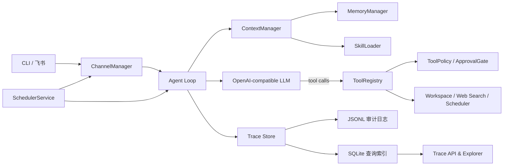

<div align="center">

# My-Agent

**多渠道对话、工具调用、风险审批、会话压缩、长期记忆、定时任务，以及可查询的完整运行链路。**

一个面向学习与工程实践的轻量级 AI Agent。

[功能](#功能概览) · [快速开始](#快速开始) · [飞书](#飞书接入) · [工具审批](#工具审批) · [压缩](#上下文压缩) · [观测](#可观测性) · [文档](#文档地址) · [FAQ](#常见问题)


</div>

`my-agent` 不只是一个聊天 Demo。项目围绕 Agent 在真实运行中需要回答的几个问题展开：

- Agent 调用了什么工具，为什么失败？
- 多轮对话如何隔离、按条数/token 压缩，并沉淀为长期记忆？
- 高风险工具如何在执行前等人确认，调度任务如何挂起等待？
- Agent 如何主动执行提醒或周期任务，并把结果送回原渠道？
- 文件和 Shell 工具如何限制在指定工作区内？
- 一次请求的 LLM、工具和渠道耗时如何被记录、查询和展示？

> 当前项目适合本地学习、原型验证和 Agent 工程能力演示。工具审批默认关闭（`TOOL_APPROVAL_MODE=off`）；尚未实现完整的用户认证、RBAC 与分布式调度，不建议未经加固直接暴露在公网或用于生产环境。

## 功能概览

| 模块 | 能力 | 状态 |
| --- | --- | --- |
| Agent Loop | OpenAI-compatible 模型调用、多步工具执行、最大步数保护 | 已实现 |
| 多渠道接入 | CLI；飞书 WebSocket 长连接、私聊与群聊 `@Bot` 响应 | 已实现 |
| 上下文管理 | 按会话隔离；条数或 token 超限时用摘要压缩，保留最近完整 turn | 已实现 |
| 工具审批 | 风险分级 L0–L3；默认 off；on 时 L2/L3 需 `/approve` `/deny`；调度任务可挂起 | 已实现 |
| 长期记忆 | 原始对话、情景记忆、语义记忆、SQLite FTS 检索、按需注入 | 已实现 |
| 记忆整理 | 异步生成 daily memory、每日 Dream 整理、工作流 SOP 提炼 | 已实现 |
| 内置工具 | Bash（argv 白名单）、文件读写与编辑、Glob、记忆、联网搜索、定时任务 | 已实现 |
| 本地技能 | 从 `skills/` 加载 `SKILL.md` 并注入上下文 | 已实现 |
| 主动任务 | 一次性提醒、固定间隔任务、Cron 任务，结果回送原渠道 | 已实现 |
| 可观测性 | Trace/Span、LLM 与工具耗时、Token 用量、错误信息、敏感字段脱敏 | 已实现 |
| Trace Explorer | 本地 Web 面板、历史筛选、Span 树、调试包、SQLite 索引修复 | 已实现 |
| 安全边界 | Workspace 路径约束、Bash 命令白名单、子进程环境变量白名单 | 已实现 |

## 技术栈

| 技术 | 版本 | 用途 |
| --- | --- | --- |
| Python | 3.9+ | 运行时 |
| OpenAI-compatible HTTP | 标准库 `urllib` | 模型调用，兼容自定义 `OPENAI_API_BASE` |
| lark-oapi | `>=1.6,<2.0` | 飞书 WebSocket 长连接渠道 |
| croniter | `>=6.0,<7.0` | Cron 任务与每日 Dream |
| tiktoken | `>=0.7,<1.0` | 上下文 token 计数与压缩触发 |
| SQLite FTS | 标准库 | 情景记忆检索、Trace 查询索引 |
| pytest | `>=8.0,<9.0` | 离线 / 安全 / 性能 / Live 测试 |

CLI 核心路径尽量依赖标准库；飞书渠道、Cron 调度和 token 计数通过 `requirements.txt` 引入。

## 工作原理



一次普通请求的主要链路如下：

```text
Channel 收到消息
  -> 为 session 创建 RunContext
  -> ContextManager 组装身份、记忆、技能和历史消息
     （超条数或 token 预算时压缩旧消息，保留最近完整 turn）
  -> LLM 决定直接回复或调用工具
  -> ToolRegistry 先过策略再执行；需要审批时推送文案并等待 /approve
  -> Agent 继续推理，直到返回答案或达到 max_steps
  -> Channel 回复用户
  -> Trace 同时写入 JSONL 和 SQLite
```

同一会话内的消息串行执行，不同会话通过线程池并行处理，避免上下文串线。

## 快速开始

### 0. 运行配置文件位置

项目运行相关文件集中在根目录：

| 文件 | 作用 |
| --- | --- |
| `requirements.txt` | 运行依赖，包含飞书渠道和 Cron 调度所需包 |
| `requirements-dev.txt` | 开发与测试依赖，包含 `pytest` |
| `.env.example` | 运行环境变量模板，复制为 `.env` 后填写真实配置 |
| `.env` | 本地真实运行配置，不应提交到 Git |
| `config.py` | 配置加载逻辑和默认值定义 |

### 1. 环境要求

- Python 3.9+
- 一个兼容 OpenAI Chat Completions 接口的模型服务
- Git

安装运行依赖：

```bash
python3 -m pip install -r requirements.txt
```

如果需要运行测试，再安装开发依赖：

```bash
python3 -m pip install -r requirements-dev.txt
```

### 2. 获取项目

```bash
git clone https://github.com/uuforeverr/My-Agent.git
cd My-Agent

python3 -m venv .venv
source .venv/bin/activate          # Linux / macOS
# .venv\Scripts\activate           # Windows
python3 -m pip install -r requirements.txt
```

### 3. 配置模型

```bash
cp .env.example .env
```

编辑 `.env`，至少填写：

```dotenv
OPENAI_API_KEY=your-api-key
OPENAI_API_BASE=https://api.openai.com/v1
MODEL=gpt-4o-mini
```

`.env` 已被 Git 忽略。不要把真实 API Key、飞书应用密钥或其他凭证提交到仓库。

### 4. 启动 CLI

```bash
python3 main.py
```

启动后可直接用自然语言下达任务：

```text
请读取 a.txt 并总结
记住：这个项目优先保证工具调用安全
搜索最近一周 Agent 可观测性的发展
30 分钟后提醒我检查测试结果
```

输入 `exit` 或 `quit` 退出。常用斜杠命令见下文「工具审批」和「长期记忆」。

## 配置说明

所有配置均通过根目录 `.env` 或系统环境变量读取。

### 基础配置

| 变量 | 默认值 | 说明 |
| --- | --- | --- |
| `OPENAI_API_KEY` | 空 | 模型服务 API Key |
| `OPENAI_API_BASE` | `https://api.openai.com/v1` | OpenAI-compatible API 地址 |
| `MODEL` | `gpt-4o-mini` | 模型名称 |
| `WORKSPACE` | `./workspace` | 文件与 Bash 工具允许访问的工作区 |
| `MAX_STEPS` | `6` | 单次 Agent 运行的最大推理/工具循环数 |
| `CHANNELS` | `cli` | 启用渠道，多个值用逗号分隔 |

### 上下文与工具

| 变量 | 默认值 | 说明 |
| --- | --- | --- |
| `MAX_HISTORY_MESSAGES` | `40` | 单个会话短期历史条数上限；超过则触发压缩 |
| `MODEL_CONTEXT_WINDOW` | 空 | 可选，显式模型窗口（token）。未设时按模型名前缀查表，未知模型回退 `32768` |
| `KEEP_RECENT_TURNS` | `3` | 压缩时保留的最近完整 turn 数（一条 user 及其后的 assistant/tool） |
| `TOOL_APPROVAL_MODE` | `off` | `off` 全部放行；`on` 按风险等级审批。仅当值为 `on` 时开启 |
| `MEMORY_SEARCH_RESULTS` | `5` | 每次注入的情景记忆检索结果数 |
| `MEMORY_FLUSH_MESSAGES` | `12` | 一次异步记忆摘要处理的最大消息数 |
| `BASH_TIMEOUT` | `20` | Bash 默认超时秒数，代码硬限制最大 30 秒 |
| `QIANFAN_API_KEY` | 空 | 百度千帆 AI Search Key；为空时隐藏 `web_search` |
| `QIANFAN_API_BASE` | `https://qianfan.baidubce.com/v2` | 千帆 API 地址 |
| `WEB_SEARCH_TIMEOUT` | `15` | 联网搜索超时秒数 |

### 调度与记忆整理

| 变量 | 默认值 | 说明 |
| --- | --- | --- |
| `SCHEDULER_ENABLED` | `true` | 是否启用调度服务及 `scheduler` 工具 |
| `SCHEDULER_SCAN_INTERVAL` | `30` | 到期任务扫描间隔，单位秒 |
| `SCHEDULER_CATCHUP_SECONDS` | `600` | 重启后的任务补偿窗口，单位秒 |
| `SCHEDULER_TASKS_PATH` | `./data/scheduler/tasks.json` | 调度任务存储路径 |
| `DAILY_DREAM_ENABLED` | `true` | 是否注册每日记忆整理任务 |
| `DAILY_DREAM_CRON` | `0 0 * * *` | 每日记忆整理的 Cron 表达式 |
| `DAILY_DREAM_LOOKBACK_DAYS` | `1` | 每次整理回看的情景记忆天数 |

### 可观测性

| 变量 | 默认值 | 说明 |
| --- | --- | --- |
| `TRACE_API_TOKEN` | 空 | Trace Explorer 可选访问令牌；为空时本地面板不校验 Token |

## 飞书接入

1. 在[飞书开放平台](https://open.feishu.cn/app)创建企业自建应用并启用机器人。
2. 开通接收消息与发送消息所需权限。
3. 使用 WebSocket 长连接订阅 `im.message.receive_v1`。
4. 安装 SDK 并配置 `.env`：

```bash
python3 -m pip install -r requirements.txt
```

```dotenv
CHANNELS=cli,feishu
FEISHU_APP_ID=cli_xxx
FEISHU_APP_SECRET=your-app-secret
```

5. 启动服务：

```bash
python3 main.py
```

私聊消息会直接进入 Agent；群聊仅响应明确 `@Bot` 的文本消息。`/approve`、`/deny`、`/summarize` 在渠道层拦截，不进入 Agent 对话。群聊中只有发起该次工具调用的用户可以审批。代码包含消息去重、过期消息过滤和 WebSocket 断线重连。

## 内置工具

| 工具 | 用途 | 可用条件 |
| --- | --- | --- |
| `bash` | 在 Workspace 中按 argv 运行白名单命令；超长输出溢写到文件 | 默认启用 |
| `glob` | 按模式查找文件 | 默认启用 |
| `read_file` | 读取 Workspace 内文件（支持 offset/limit） | 默认启用 |
| `write_file` | 写入 Workspace 内文件 | 默认启用 |
| `edit_file` | 精确编辑 Workspace 内文件 | 默认启用 |
| `remember_memory` | 写入长期语义记忆 | 默认启用 |
| `memory_search` | 检索情景记忆 | 默认启用 |
| `read_memory` | 读取记忆内容 | 默认启用 |
| `web_search` | 百度千帆联网搜索 | 配置 `QIANFAN_API_KEY` |
| `scheduler` | 创建、查询、更新和删除任务 | `SCHEDULER_ENABLED=true` |

文件工具会解析并校验真实路径，拒绝访问 Workspace 外部。

`bash` 使用 `shell=False`：先 `shlex.split`，禁止管道/重定向/命令链，`argv[0]` 必须是白名单短名（`python` / `python3` / `py` / `pytest` / `pip` / `git` / `rg` / `node` / `npm` / `npx` / `ruff` / `mypy`），再用 `shutil.which` 解析后执行。不包含 `echo`、`cat`、`curl` 等；短文本请用 `python -c`。凭证、绝对路径、路径穿越、提权和删根等黑名单仍作为第二道闸。超时上限 30 秒。

工具成功输出超过 **2000 tokens** 时，全文写入 `workspace/.agent/tool_outputs/`，返回给模型的是头尾预览加路径，可用 `read_file` 的 offset/limit 续读。`read_file` 本身不重复溢写。`.agent/` 已被 Git 忽略。

这些规则是基础防护，不等同于容器沙箱。默认 `TOOL_APPROVAL_MODE=off` 时不会弹出人工审批。运行来源不可信的提示词前，应使用独立低权限环境，并考虑打开审批。

## 工具审批

默认 `TOOL_APPROVAL_MODE=off`，行为与打开审批前一致。生产或本地想拦截高风险调用时设为 `on`：

```dotenv
TOOL_APPROVAL_MODE=on
```

| 等级 | `on` 时的行为 | 典型工具 |
| --- | --- | --- |
| L0 | 直接执行 | `glob`、`read_file`、`memory_search`、`read_memory`、`scheduler.list/get` |
| L1 | 直接执行；写文件预览只记 Trace，不推渠道 | `write_file`、`edit_file`、`remember_memory` |
| L2 | 交互会话等待审批；调度任务挂起 | `bash`、`scheduler.create/delete/enable/disable` |
| L2 网络只读 | 执行并记 Trace，不审批 | `web_search` |
| L3 | 与 L2 相同（本轮无独立 L3 工具） | 预留 |

交互路径超时 **120 秒**视为拒绝且工具未执行。调度任务不阻塞扫描线程，进入 `waiting_approval`，超时 **24 小时**；批准后在线程池里续跑，拒绝或进程重启会使本次失败（once 任务 disable，周期任务前进到下次）。

CLI / 飞书（不进入 Agent 对话）：

```text
/approve <id>           # 仅批准这一次
/approve <id> session   # 本会话允许同类工具再次执行
/deny <id>              # 拒绝
```

审批文案含操作 ID、工具名、风险等级和脱敏后的参数。敏感字段会 redacted。

## 上下文压缩

组装发给模型的消息时，满足任一条件就会压缩：

- 短期 history 条数超过 `MAX_HISTORY_MESSAGES`（默认 40）
- 本次 payload（system + history + 工具 schema）超过模型窗口的 **80%**（可用 `MODEL_CONTEXT_WINDOW` 覆盖窗口）

压缩只处理旧消息：最近 `KEEP_RECENT_TURNS`（默认 3）个完整 turn 原样保留。被替换的旧消息写成一条 `conversation_summary` 留在 history 里，并仍会 `flush` 到 daily 情景记忆。压缩 LLM 失败时不丢 history。

手动触发（渠道拦截，不进 Agent.run）：

```text
/summarize
```

token 计数使用 tiktoken。未知模型不抛错，窗口回退 32768。

## 长期记忆

记忆系统采用“事实存储、整理结果、检索索引”分层设计：

```text
data/memory/
├── raw/<session>/<date>.jsonl  # 原始对话，追加写入
├── daily/<date>.md             # 情景记忆摘要
├── MEMORY.md                   # 长期稳定的语义记忆
├── workflows/SOP.md            # 从历史中提炼的工作流
├── dreams/<date>.md            # Dream 整理日志
└── index.db                    # 情景记忆 SQLite/FTS 检索索引
```

- 语义记忆会完整注入上下文。
- 情景记忆根据当前问题 Top-K 检索后注入。
- 会话压缩替换掉的旧消息，仍会异步总结到 daily memory。
- Daily Dream 会整理近期记忆并重写长期语义记忆。

CLI 管理命令：

```text
/dream      # 立即整理最近一天的记忆
/sop        # 提炼最近 3 天的工作流
/sop 7      # 提炼最近 7 天的工作流
/summarize  # 手动压缩当前会话（不进 Agent 对话）
```

## 定时任务

Agent 支持三种调度方式：

- `once`：一次性执行，例如 `+10m`、`+1h` 或 ISO 时间。
- `interval`：按固定秒数重复执行。
- `cron`：Cron 表达式，需要安装 `croniter`。

支持三类用户动作：

- `send_message`：到点发送固定文本。
- `agent_task`：到点创建隔离会话，让 Agent 执行任务并返回结果。
- `tool_call`：到点直接调用指定工具。

示例：

```text
10 分钟后提醒我休息
每小时搜索一次 AI Agent 最新动态
每天早上 9 点总结今天的待办事项
```

调度任务保存在 `data/scheduler/tasks.json`，并通过原始 Channel 主动回送结果。定时 Agent 任务中会隐藏 `scheduler`，防止任务递归创建任务。`memory_dream` / `send_message` 不走工具审批。

`TOOL_APPROVAL_MODE=on` 时，到期任务里的 L2/L3 不会卡住扫描线程，而是把任务标为 `waiting_approval`，向原渠道发送审批文案；`/approve` 后再续跑并投递结果。

## 可观测性

每次请求都会生成 Trace，常见 Span 类型包括：

- `channel.handle` / `channel.send`
- `agent.invoke`
- `llm.chat`
- `tool.execute` / `tool.policy`
- `context.compact`

Trace 包含执行状态、耗时、模型、Token 用量、工具结果大小和错误信息。序列化时会对 `api_key`、`token`、`secret`、`authorization`、`password`、`cookie` 等敏感字段脱敏。

CLI 查询命令：

```text
/trace
/trace <trace_id>
/traces
/traces 20
/traces 20 status=error
/traces 20 session_id=cli:local entrypoint=cli
/traces 20 before=<trace_id>
```

底层存储：

```text
data/observability/traces.jsonl  # append-only 审计记录
data/observability/traces.db     # SQLite 查询索引
```

### Trace Explorer

启动只读 API 和本地面板：

```bash
python3 -m observability.api --host 127.0.0.1 --port 8765
```

浏览器访问：

```text
http://127.0.0.1:8765/dashboard
```

可选访问 Token：

```bash
TRACE_API_TOKEN=dev-token \
  python3 -m observability.api --host 127.0.0.1 --port 8765
```

配置 Token 后，API 请求需携带以下任一请求头：

```text
Authorization: Bearer <token>
X-Trace-Api-Token: <token>
```

主要端点：

```text
GET  /api/health
GET  /api/auth/check
GET  /api/overview
GET  /api/traces?limit=20&status=error
GET  /api/traces/<trace_id>
GET  /api/traces/<trace_id>/bundle
POST /api/index/repair
POST /api/index/rebuild
```

SQLite 查询缺失时会回查 JSONL 并修复索引；也可以通过 API 手动增量修复或完整重建。

## 开发指南

### 本地开发

```bash
git clone https://github.com/uuforeverr/My-Agent.git
cd My-Agent
python3 -m venv .venv
source .venv/bin/activate
python3 -m pip install -r requirements-dev.txt
cp .env.example .env
```

### 测试

安装测试依赖并运行完整离线测试：

```bash
python3 -m pip install -r requirements-dev.txt
python3 -m pytest
```

按类型运行：

```bash
python3 -m pytest -m security
python3 -m pytest -m performance
```

真实模型端到端测试默认不会调用外部服务。显式启用时会产生 API 费用：

```bash
RUN_LIVE_LLM=1 python3 -m pytest -m live
```

### 贡献指南

欢迎 Issue 与 Pull Request。建议：

1. Fork 本仓库并新建分支。
2. 改动尽量小，优先复用现有 `agent/`、`tools/`、`observability/` 风格。
3. 涉及安全边界、调度或记忆的改动，请补充对应测试。
4. 不要提交 `.env`、真实密钥、本地 `data/` 运行产物。

## 项目结构

```text
my-agent/
├── agent/             # Agent Loop、上下文压缩与运行上下文
├── channel/           # CLI、飞书与渠道调度
├── llm/               # OpenAI-compatible HTTP 客户端
├── memory/            # 多层记忆、检索、Dream 与 SOP
├── observability/     # Trace、SQLite、API 与 Web 面板
├── scheduler/         # 任务存储、时间计算、执行与后台扫描
├── skills/            # 本地 SKILL.md 加载
├── tools/             # 工具定义、风险策略、审批与安全边界
├── prompts/           # 文件化身份提示词
├── tests/             # 离线、性能、安全及 Live 测试
├── docs/              # 设计说明、路线与测试文档
├── workspace/         # Agent 默认工作区
├── requirements.txt   # 运行依赖
├── requirements-dev.txt # 开发与测试依赖
├── .env.example       # 环境变量模板
├── config.py          # 环境变量配置
└── main.py            # 进程入口
```

## 文档地址

设计说明、路线与测试文档都在 [`docs/`](docs/)：

| 文档 | 说明 |
| --- | --- |
| [`docs/python-code-walkthrough.md`](docs/python-code-walkthrough.md) | 代码走读 |
| [`docs/memory-architecture.md`](docs/memory-architecture.md) | 记忆架构 |
| [`docs/channel-design-walkthrough.md`](docs/channel-design-walkthrough.md) | 渠道设计 |
| [`docs/scheduler-design-for-beginners.md`](docs/scheduler-design-for-beginners.md) | 调度入门 |
| [`docs/agent-observability-control-plane.md`](docs/agent-observability-control-plane.md) | 观测控制面 |
| [`docs/minimal-implementation-roadmap.md`](docs/minimal-implementation-roadmap.md) | 最小化实现路线 |
| [`docs/tool-policy-and-context-compaction-plan.md`](docs/tool-policy-and-context-compaction-plan.md) | 工具审批与上下文压缩方案 |
| [`docs/test-plan.md`](docs/test-plan.md) / [`docs/test-report.md`](docs/test-report.md) | 测试计划与报告 |

## 常见问题

<details>
<summary>没有配置 API Key 能启动吗？</summary>

可以启动 CLI / 飞书渠道进程，但模型调用会失败。至少填写 `OPENAI_API_KEY`；使用中转时同时设置 `OPENAI_API_BASE` 和 `MODEL`。

</details>

<details>
<summary>飞书机器人不回复？</summary>

确认 `CHANNELS` 包含 `feishu`，`FEISHU_APP_ID` / `FEISHU_APP_SECRET` 正确，应用已开通收发消息权限，并订阅 `im.message.receive_v1`。群聊只会响应明确 `@Bot` 的文本消息；私聊会直接进入 Agent。

</details>

<details>
<summary>为什么模型看不到 web_search？</summary>

未配置 `QIANFAN_API_KEY` 时，联网搜索工具会从工具列表中隐藏，避免模型调用不可用能力。

</details>

<details>
<summary>Cron 任务或每日 Dream 不生效？</summary>

确认已安装 `requirements.txt`（包含 `croniter`），且 `SCHEDULER_ENABLED=true`。Daily Dream 还需要 `DAILY_DREAM_ENABLED=true`。任务文件默认在 `data/scheduler/tasks.json`。

</details>

<details>
<summary>Trace Explorer 打不开或接口 401？</summary>

先启动 `python3 -m observability.api --host 127.0.0.1 --port 8765`，再访问 `http://127.0.0.1:8765/dashboard`。若设置了 `TRACE_API_TOKEN`，请求需带 `Authorization: Bearer <token>` 或 `X-Trace-Api-Token`。

</details>

<details>
<summary>可以把服务直接挂到公网吗？</summary>

不建议。当前没有完整用户认证、RBAC 和分布式调度；工具审批默认关闭（`TOOL_APPROVAL_MODE=off`），文件与 Shell 工具也只是 Workspace 级防护。请在本地或隔离环境运行。

</details>

## 当前边界与路线

已实现的是单机 Agent 执行内核、本地观测闭环，以及工具风险分级、执行前审批和会话压缩。后续重点方向：

1. 飞书交互卡片 / 团队 Web 审批工作台。
2. Workflow/Step 一等模型及显式状态机。
3. 幂等执行、重试策略、超时恢复与可靠调度。
4. Workspace、用户身份、RBAC 与集中式密钥管理。
5. OpenTelemetry 标准接入和基于 Trace 的 Agent Eval。
6. Docker Compose 自托管部署与团队 Web 工作台。

更多设计背景见 [`docs/`](docs/)，本期方案见 [`docs/tool-policy-and-context-compaction-plan.md`](docs/tool-policy-and-context-compaction-plan.md)。

## 作者联系

- **GitHub**: [uuforeverr](https://github.com/uuforeverr)

## 项目统计

| 项 | 值 |
| --- | --- |
| 仓库 | [uuforeverr/My-Agent](https://github.com/uuforeverr/My-Agent) |
| 主要语言 | Python |
| 运行依赖 | `lark-oapi`、`croniter`、`tiktoken`（CLI 核心走标准库） |

## License

本仓库暂未添加 `LICENSE` 文件，使用或二次分发前请先通过 Issue 与作者确认。欢迎补充标准开源协议。

## Star History

如果这个项目对你有帮助，欢迎点一个 Star ⭐

[](https://star-history.com/#uuforeverr/My-Agent&Date)
