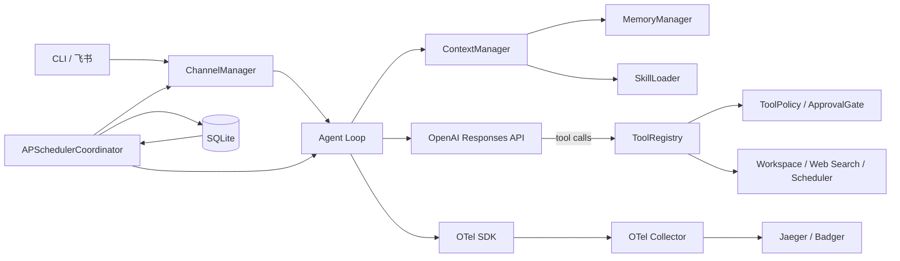

<div align="center">

# My-Agent

**面向个人使用的轻量级 Agent：分层记忆、可靠调度、受控工具调用与端到端可观测性。**

一个面向学习与工程实践的轻量级 AI Agent。

[功能](#功能概览) · [快速开始](#快速开始) · [飞书](#飞书接入) · [工具审批](#工具审批) · [压缩](#上下文压缩) · [观测](#可观测性) · [文档](#文档地址) · [FAQ](#常见问题)


</div>

`my-agent` 不只是一个聊天 Demo。项目围绕 Agent 在真实运行中需要回答的几个问题展开：

- Agent 调用了什么工具，为什么失败？
- 多轮对话如何按会话隔离、压缩、重启后从原文恢复，并沉淀为长期记忆？
- 高风险工具如何在执行前等人确认，调度任务如何挂起等待？
- Agent 如何主动执行提醒或周期任务，并把结果送回原渠道？
- 文件和 Shell 工具如何限制在指定工作区内？
- 一次请求的 LLM、工具和渠道耗时如何被记录、查询和展示？

> 当前项目适合本地学习、原型验证和 Agent 工程能力演示。工具治理默认采用 `TOOL_APPROVAL_MODE=risk_based`：R0/R1 自动执行，R2 逐次审批；尚未实现完整的用户认证、RBAC 与分布式调度，不建议未经加固直接暴露在公网或用于生产环境。

## 功能概览

| 模块 | 能力 | 状态 |
| --- | --- | --- |
| Agent Loop | OpenAI Responses API 流式调用、多步工具执行、最大步数保护 | 已实现 |
| 多渠道接入 | CLI；飞书 WebSocket 长连接、私聊与群聊 `@Bot` 响应；`/new` 开新会话 | 已实现 |
| 上下文管理 | 按 conversation 隔离；重启从 raw 回放短期窗口；条数或 token 超限时压缩，保留最近完整 turn | 已实现 |
| 工具审批 | 风险分级 R0–R2；默认 risk_based，R2 需 `/approve` `/deny`；调度任务可挂起 | 已实现 |
| 长期记忆 | 原始对话、情景记忆、语义记忆、SQLite FTS 检索、按需注入 | 已实现 |
| 记忆整理 | 按 raw 水位线后台扫描生成 daily、每日 Dream 整理、工作流 SOP 提炼 | 已实现 |
| 内置工具 | Docker 沙箱 Bash、文件读写与编辑、Glob、记忆、联网搜索、定时任务 | 已实现 |
| 本地技能 | 从 `skills/` 加载 `SKILL.md` 并注入上下文 | 已实现 |
| 主动任务 | 一次性提醒、固定间隔任务、Cron 任务，结果回送原渠道 | 已实现 |
| 可观测性 | 原生 OpenTelemetry Trace、LLM/工具时延、Token、错误与内容脱敏 | 已实现 |
| Trace 查询 | 本机 Collector、Jaeger UI、Badger 30 天持久化 | 已实现 |
| 安全边界 | Workspace 路径约束、Bash Docker 隔离、断网与资源限制 | 已实现 |

## 技术栈

| 技术 | 版本 | 用途 |
| --- | --- | --- |
| Python | 3.10+ | 运行时；当前完整测试使用 Python 3.10，沙箱使用 Python 3.11 |
| OpenAI Python SDK | `>=3.0,<4.0` | Responses API、类型化流事件与工具调用 |
| APScheduler | `>=3.11,<4.0` | 到点触发任务；SQLite 负责持久化状态 |
| OpenTelemetry | `>=1.33,<2.0` | 原生 Trace SDK 与 OTLP/HTTP 导出 |
| lark-oapi | `>=1.6,<2.0` | 飞书 WebSocket 长连接渠道 |
| croniter | `>=6.0,<7.0` | Cron 任务与每日 Dream |
| tiktoken | `>=0.7,<1.0` | 上下文 token 计数与压缩触发 |
| SQLite FTS | 标准库 | 情景记忆检索 |
| pytest | `>=8.0,<9.0` | 离线 / 安全 / 性能 / Live 测试 |

运行依赖统一声明在 `requirements.txt`，测试依赖位于 `requirements-dev.txt`。

## 已验证结果

- **可靠调度：** 强制终止并重启真实调度进程后，持久化任务与待投递结果均可恢复；20 个代表性任务同时到期时，95% 在约 1.7 秒内完成交付。
- **工具治理：** 26 个可执行攻击与边界样例全部被阻断，10 个正常任务全部执行成功。
- **代码回归：** 当前提交执行完整离线测试为 `437 passed, 4 skipped`。

调度与工具治理的实验设计、限制和复现方式见 [`docs/scheduler-and-tool-governance-implementation-plan.md`](docs/scheduler-and-tool-governance-implementation-plan.md)；实验脚本位于 [`scripts/effect_validation/`](scripts/effect_validation/)。外部 LLM 与工具主体在调度基准中使用确定性替身，因此 1.7 秒衡量的是调度与结果投递链路，不代表真实模型任务的完整响应时间。

## 工作原理



一次普通请求的主要链路如下：

```text
Channel 收到消息
  -> 为 session（`channel:scope:conversation_id`）创建 RunContext
  -> 若该会话尚无内存 history，从 SQLite 恢复最近 N 个 complete Turn
  -> ContextManager 组装身份、记忆、技能和历史消息
     （超 SessionWindow 或 token 预算时移出最老完整 Turn）
  -> LLM 决定直接回复或调用工具
  -> ToolRegistry 先过策略再执行；需要审批时推送文案并等待 /approve
  -> Agent 继续推理，直到返回答案或达到 max_steps
  -> 飞书 Flush Worker 批量刷新回复
  -> CLI 直接流式输出允许展示的模型文本 delta
  -> OTel SDK 异步导出 Trace 到本机 Collector 和 Jaeger
```

同一 conversation 内的消息串行执行，不同 conversation 通过线程池并行处理，避免上下文串线。CLI / 飞书可用 `/new` 开启新会话；长期记忆仍按用户共享，不按 conversation 过滤。

## 快速开始

### 0. 运行配置文件位置

项目运行相关文件集中在根目录：

| 文件 | 作用 |
| --- | --- |
| `requirements.txt` | 运行依赖，包含飞书渠道和 Cron 调度所需包 |
| `requirements-dev.txt` | 开发与测试依赖，包含 `pytest` |
| `.env.example` | 运行环境变量模板，复制为 `.env` 后填写真实配置 |
| `.env` | 本地真实运行配置，不应提交到 Git |
| `config.py` | 配置加载逻辑和默认值定义 |

### 1. 环境要求

- Python 3.10+
- 一个兼容 OpenAI Responses API 的模型服务
- Git

安装运行依赖：

```bash
python3 -m pip install -r requirements.txt
```

如果需要运行测试，再安装开发依赖：

```bash
python3 -m pip install -r requirements-dev.txt
```

### 2. 获取项目

```bash
git clone https://github.com/uu999/My-Agent.git
cd My-Agent

python3 -m venv .venv
source .venv/bin/activate          # Linux / macOS
# .venv\Scripts\activate           # Windows
python3 -m pip install -r requirements.txt
```

### 3. 配置模型

```bash
cp .env.example .env
```

编辑 `.env`，至少填写：

```dotenv
OPENAI_API_KEY=your-api-key
OPENAI_API_BASE=https://api.openai.com/v1
MODEL=gpt-4o-mini
```

`.env` 已被 Git 忽略。不要把真实 API Key、飞书应用密钥或其他凭证提交到仓库。

### 4. 启动 CLI

```bash
python3 main.py
```

启动后可直接用自然语言下达任务：

```text
请读取 a.txt 并总结
记住：这个项目优先保证工具调用安全
搜索最近一周 Agent 可观测性的发展
30 分钟后提醒我检查测试结果
```

输入 `exit` 或 `quit` 退出。常用斜杠命令见下文「工具审批」「上下文压缩」和「长期记忆」（含 `/new`）。

## 配置说明

所有配置均通过根目录 `.env` 或系统环境变量读取。

### 基础配置

| 变量 | 默认值 | 说明 |
| --- | --- | --- |
| `OPENAI_API_KEY` | 空 | 模型服务 API Key |
| `OPENAI_API_BASE` | `https://api.openai.com/v1` | OpenAI-compatible API 地址 |
| `MODEL` | `gpt-4o-mini` | 模型名称 |
| `WORKSPACE` | `./workspace` | 文件与 Bash 工具允许访问的工作区 |
| `MAX_STEPS` | `6` | 单次 Agent 运行的最大推理/工具循环数 |
| `CHANNELS` | `cli` | 启用渠道，多个值用逗号分隔 |

### 上下文与工具

| 变量 | 默认值 | 说明 |
| --- | --- | --- |
| `SESSION_WINDOW_TURNS` | `20` | 每个 Session 保留的最近完整 Turn 数 |
| `MODEL_CONTEXT_WINDOW` | 空 | 可选，显式模型窗口（token）。未设时按模型名前缀查表，未知模型回退 `32768` |
| `TOOL_APPROVAL_MODE` | `risk_based` | `risk_based`：R0/R1 自动执行、R2 逐次审批；也可选 `always` 或 `never` |
| `MEMORY_SEARCH_RESULTS` | `5` | 每次注入的情景记忆检索结果数 |
| `RAW_WRITE_BATCH_SIZE` | `32` | SQLite Raw Writer 单次批量提交条数 |
| `RAW_WRITE_FLUSH_INTERVAL_MS` | `100` | Raw 批量提交的时间兜底 |
| `RAW_WRITE_QUEUE_CAPACITY` | `4096` | Raw 内存写队列上限；队列满时显式报错，不静默丢弃 |
| `BASH_TIMEOUT` | `20` | Bash 默认超时秒数，代码硬限制最大 30 秒 |
| `SANDBOX_IMAGE` | `my-agent-sandbox:py311-v1` | Bash 使用的项目沙箱镜像 |
| `SANDBOX_NETWORK` | `none` | 沙箱网络模式；默认完全断网 |
| `SANDBOX_MEMORY` / `SANDBOX_CPUS` | `512m` / `1` | 单次容器资源上限 |
| `QIANFAN_API_KEY` | 空 | 百度千帆 AI Search Key；为空时隐藏 `web_search` |
| `QIANFAN_API_BASE` | `https://qianfan.baidubce.com/v2` | 千帆 API 地址 |
| `WEB_SEARCH_TIMEOUT` | `15` | 联网搜索超时秒数 |

### 调度与记忆整理

| 变量 | 默认值 | 说明 |
| --- | --- | --- |
| `SCHEDULER_ENABLED` | `true` | 是否启用调度服务及 `scheduler` 工具 |
| `STATE_DB_PATH` | `./data/state.db` | 调度、运行、投递、会话和记忆索引的 SQLite 状态库 |
| `SCHEDULER_TASKS_PATH` | `./data/scheduler/tasks.json` | 仅用于首次迁移旧任务；运行时不再写入 |
| `SCHEDULER_TIMEZONE` | `Asia/Shanghai` | APScheduler 时区 |
| `SCHEDULER_MAX_WORKERS` | `2` | 定时任务执行池并发数 |
| `OUTBOX_RELAY_INTERVAL_SECONDS` | `15` | 后台补发待投递结果的检查间隔 |
| `OUTBOX_RELAY_BATCH_SIZE` | `20` | 单次补发扫描的最大记录数 |
| `OUTBOX_DELIVERY_LEASE_SECONDS` | `120` | 投递 Worker 异常退出后的租约恢复时间 |
| `DAILY_DREAM_ENABLED` | `true` | 是否注册每日记忆整理任务 |
| `DAILY_DREAM_CRON` | `0 0 * * *` | 每日记忆整理的 Cron 表达式 |
| `EPISODIC_BATCH_TURNS` | `20` | PendingBuffer 达到多少 Turn 时批量提炼 |
| `EPISODIC_MAX_WAIT_SECONDS` | `3600` | 最老 Pending Turn 的最大等待时间 |
| `EPISODIC_WORKER_POLL_SECONDS` | `60` | 后台 Worker 检查超时 Buffer 的间隔 |
| `EPISODIC_BODY_MAX_CHARS` | `60` | 单条 Episodic 事件正文字符硬上限；时间不进入正文 |
| `MEMORY_EMBEDDING_PROVIDER` | `local` | 情景记忆向量提供方；`local` 使用 sentence-transformers |
| `MEMORY_EMBEDDING_MODEL` | `BAAI/bge-small-zh-v1.5` | 本地向量模型；离线模式需提前缓存模型 |
| `MEMORY_EMBEDDING_LOCAL_FILES_ONLY` | `false` | 是否只读取本地模型缓存；首次下载 BGE 后可设为 `true` |
| `MEMORY_VECTOR_BACKEND` | `auto` | 优先 sqlite-vec，不可用时回退 Python 向量计算 |

真实模型端到端验证可执行：

```powershell
.\.venv\Scripts\python.exe -X utf8 scripts/e2e_memory_system.py
```

测试使用隔离的 `data/e2e-memory/<timestamp>/`，不会写入正式 `data/state.db`。

### 可观测性

| 变量 | 默认值 | 说明 |
| --- | --- | --- |
| `MY_AGENT_OTEL_ENABLED` | `true` | 是否异步导出 OTel Trace；关闭不影响 Agent 功能 |
| `OTEL_EXPORTER_OTLP_ENDPOINT` | `http://127.0.0.1:4318` | 本机 Collector OTLP/HTTP 地址 |
| `OTEL_SERVICE_NAME` | `my-agent` | Jaeger 中的服务名 |
| `OTEL_RESOURCE_ENVIRONMENT` | `local` | 部署环境资源属性 |
| `MY_AGENT_OTEL_CAPTURE_CONTENT` | `true` | 是否记录完整正文；敏感字段先脱敏 |
| `MY_AGENT_OTEL_CONTENT_MAX_BYTES` | `1000000` | 单个内容事件的最大字节数 |
| `FEISHU_STREAM_FLUSH_INTERVAL` | `0.75` | 飞书流式回复批量刷新间隔（秒） |
| `FEISHU_STREAM_FLUSH_CHARS` | `120` | 累计多少字符后提前刷新 |

## 飞书接入

1. 在[飞书开放平台](https://open.feishu.cn/app)创建企业自建应用并启用机器人。
2. 开通接收消息与发送消息所需权限。
3. 使用 WebSocket 长连接订阅 `im.message.receive_v1`，并在「事件与回调 → 回调配置」中添加 `card.action.trigger`（工具审批按钮依赖此回调）。
4. 安装 SDK 并配置 `.env`：

```bash
python3 -m pip install -r requirements.txt
```

```dotenv
CHANNELS=cli,feishu
FEISHU_APP_ID=cli_xxx
FEISHU_APP_SECRET=your-app-secret
```

5. 启动服务：

```bash
python3 main.py
```

私聊消息会直接进入 Agent；群聊仅响应明确 `@Bot` 的文本消息。飞书中的工具审批以 Card 2.0 交互卡片呈现；R2 只显示「仅本次允许」和「拒绝」，不会形成会话授权。处理后原卡片会更新为最终状态。`/new`、`/approve`、`/deny`、`/summarize` 仍作为兼容命令在渠道层拦截，不进入 Agent 对话。`/new` 会切换当前 conversation（私聊按用户，群聊按群），短期窗口与 raw 按新 `session_id` 隔离，长期记忆仍共享。群聊中只有发起该次工具调用的用户可以审批。代码包含消息去重、过期消息过滤和 WebSocket 断线重连。

## 内置工具

| 工具 | 用途 | 可用条件 |
| --- | --- | --- |
| `bash` | 在无网络、最小权限 Docker 沙箱中运行命令；超长输出溢写到文件 | 默认启用 |
| `glob` | 按模式查找文件 | 默认启用 |
| `read_file` | 读取 Workspace 内文件（支持 offset/limit） | 默认启用 |
| `write_file` | 写入 Workspace 内文件 | 默认启用 |
| `edit_file` | 精确编辑 Workspace 内文件 | 默认启用 |
| `remember_memory` | 写入长期语义记忆 | 默认启用 |
| `memory_search` | 检索情景记忆 | 默认启用 |
| `read_memory` | 读取记忆内容 | 默认启用 |
| `web_search` | 百度千帆联网搜索 | 配置 `QIANFAN_API_KEY` |
| `scheduler` | 创建、查询、更新和删除任务 | `SCHEDULER_ENABLED=true` |

文件工具会解析并校验真实路径，拒绝访问 Workspace 外部。

`bash` 始终在一次性 Docker 容器中通过 `/bin/sh -lc` 执行，网络为 `none`，根文件系统只读，移除 capabilities，并启用 `no-new-privileges` 与资源限制。默认 `read_only` 只读挂载 Workspace（R1）；只有显式 `workspace_write` 才可写工作区（R2，逐次审批）。涉及 `.env`、API Key 或删除工作区根目录的命令仍会被硬拒绝。超时上限 30 秒。

首次使用 Bash 前构建固定工具镜像（包含 Python 3.11、`ripgrep` 与 `pytest`）：

```bash
docker build -f docker/sandbox/Dockerfile -t my-agent-sandbox:py311-v1 .
```

工具成功输出超过 **2000 tokens** 时，全文写入 `workspace/.agent/tool_outputs/`，返回给模型的是头尾预览加路径，可用 `read_file` 的 offset/limit 续读。`read_file` 本身不重复溢写。`.agent/` 已被 Git 忽略。

这些规则与审批是两层控制：审批决定是否允许调用，Bash 获准后仍由 Docker 沙箱限制网络、挂载、权限和资源。运行来源不可信的提示词时仍应使用独立低权限环境。

## 工具审批

默认采用风险分级审批：

```dotenv
TOOL_APPROVAL_MODE=risk_based
```

| 等级 | `risk_based` 行为 | 典型工具 |
| --- | --- | --- |
| R0 | 自动执行 | `glob`、`read_file`、`memory_search`、`read_memory`、`scheduler.list/get` |
| R1 | 自动执行；写文件预览只记 Trace，不推渠道 | `write_file`、`edit_file`、`remember_memory`、`web_search`、`bash read_only` |
| R2 | 交互会话等待逐次审批；调度任务挂起 | `bash workspace_write`、`scheduler.create/delete/enable/disable` |

`always` 会要求所有 R0–R2 调用审批；`never` 不要求人工审批，但未知风险等级仍拒绝，参数 Schema、路径边界、敏感信息硬禁止和 Docker 沙箱始终生效。系统不定义 R3 工具。

交互路径超时 **120 秒**视为拒绝且工具未执行。调度任务不阻塞扫描线程，进入 `waiting_approval`，超时 **24 小时**；批准后在线程池里续跑，拒绝或进程重启会使本次失败（once 任务 disable，周期任务前进到下次）。

CLI，以及飞书卡片不可用时的兼容方式（不进入 Agent 对话）：

```text
/approve <id>           # 仅批准这一次
/approve <id> session   # 仅 always 下的 R0/R1 可形成会话授权；R2 会自动降级为仅本次
/deny <id>              # 拒绝
```

审批信息含操作 ID、工具名、风险等级和脱敏后的参数。敏感字段会 redacted。飞书默认发送交互卡片；卡片发送失败时自动回退到上述文本命令。所有 R2 操作只允许精确的一次性批准，因此其卡片不会展示「本会话允许」。

## 上下文压缩

组装发给模型的消息时，满足任一条件就会移出旧 Turn：

- Session 的完整 Turn 数超过 `SESSION_WINDOW_TURNS`（默认 20）
- 本次 payload（system + history + 工具 schema）超过模型窗口的 **80%**（可用 `MODEL_CONTEXT_WINDOW` 覆盖窗口）

移出以完整 Turn 为单位，不同步调用 LLM，也不在 history 中生成 `conversation_summary`。移出的 Turn 进入内存 PendingBuffer；后台 Episodic Worker 达到 20 Turn 或最老 Turn 等待超过 1 小时后异步提炼。进程重启后，从 SQLite 按 `session_id + turn_seq + message_seq` 恢复最近 N 个 complete Turn，并根据持久化游标重建遗漏的 Buffer。

手动触发（渠道拦截，不进 Agent.run）：

```text
/summarize
```

token 计数使用 tiktoken。未知模型不抛错，窗口回退 32768。

## 长期记忆

记忆系统采用“事实存储、整理结果、检索索引”分层设计：

```text
data/memory/
├── MEMORY.md                      # 长期稳定的语义记忆（每次全量注入）
├── workflows/SOP.md               # 从历史中提炼的工作流
└── dreams/<date>.md               # Dream 整理日志

data/state.db                      # Raw Turn/Message、Episodic、游标、FTS/向量、调度与投递状态
```

- 短期窗口跟 Session 走；`/new` 换新窗口，重启后只恢复最近 N 个 complete Turn（含 assistant/tool 配对）。
- 语义记忆完整注入上下文；情景记忆按当前问题 Top-K 检索后注入。二者都不按 conversation 过滤。
- Episodic Worker 只消费离开 SessionWindow 的 Turn；成功写入 Episodic 与推进游标处于同一事务，失败时 Buffer 不弹出。
- Episodic 正文仅保留关键背景、过程和结果，稳定事实与经验作为精简元数据；检索使用 SQLite BM25 + Vector + RRF。
- Daily Dream 按游标读取未处理 Episodic，并通过 ADD / UPDATE / SUPERSEDE / NOOP 操作局部更新带稳定 ID 的 `MEMORY.md`。

CLI 管理命令：

```text
/new        # 开启新会话（CLI / 飞书；不进 Agent 对话）
/dream      # 立即消费 Dream 游标之后尚未处理的情景记忆
/sop        # 提炼最近 3 天的工作流
/sop 7      # 提炼最近 7 天的工作流
/summarize  # 手动压缩当前会话（不进 Agent 对话）
```

## 定时任务

Agent 支持三种调度方式：

- `once`：一次性执行，例如 `+10m`、`+1h` 或 ISO 时间。
- `interval`：按固定秒数重复执行。
- `cron`：Cron 表达式，需要安装 `croniter`。

支持三类用户动作：

- `send_message`：到点发送固定文本。
- `agent_task`：到点创建隔离会话，让 Agent 执行任务并返回结果。
- `tool_call`：到点直接调用指定工具。

示例：

```text
10 分钟后提醒我休息
每小时搜索一次 AI Agent 最新动态
每天早上 9 点总结今天的待办事项
```

APScheduler 负责到点触发，SQLite 持久化任务定义、下一执行时间、运行结果和待投递记录。进程重启后，协调器从 SQLite 重建未完成调度；错过多次的周期任务只追赶最近一次。任务结果先写入待投递记录，正常路径立即发送，进程中断或可重试失败时由低频 Relay 补发。定时 Agent 任务中会隐藏 `scheduler`，防止递归创建任务。

时间语义分为 `notify_at`（准时提醒）、`start_at`（准时开工）和 `deliver_by`（提前执行、准时释放结果）。`deliver_by` 的提前量根据成功历史自动调整；首次创建会立即测试执行与原渠道投递，验证成功后才启用正式计划，并回报测试耗时和参考提前量。

`TOOL_APPROVAL_MODE=risk_based` 时，到期任务里的 R2 不会卡住调度线程，而是把任务标为 `waiting_approval`，向原渠道发送审批文案；`/approve` 后按原工具名和完整参数续跑并投递结果。

## 可观测性

第一阶段只建设交互式 Turn 的 Trace。每条用户消息对应一条 Trace，核心父子关系为：

```text
turn my-agent
├─ receive_request <channel>
├─ invoke_agent my-agent
│  ├─ agent.step 1
│  │  ├─ assemble_context
│  │  │  └─ retrieval memory
│  │  ├─ chat <model>
│  │  └─ execute_tool <tool>
│  └─ agent.step 2
│     ├─ assemble_context
│     └─ chat <model>
└─ send_response <channel>
```

Trace 记录排队耗时、首事件/首文本时延、完整模型输入输出、Token、memory 检索、工具参数与结构化结果、飞书刷新和异常。`api_key`、`authorization`、`cookie`、密码与 token 等敏感字段在进入 OTel 前统一脱敏。当前不采集独立 Metrics/Logs、CPU/RSS、全量 HTTP Span，也不提供业务 Dashboard 或告警。

`receive_request` 记录平台消息时间、本机接收、入队和 Worker 启动；每次 Agent 推理循环由一个 `agent.step N` 分组。`send_response` 从首个可展示输出进入缓冲区开始，每次批量刷新记录为 Event；根 Turn 等到最终刷新成功或失败后才结束，因此 Trace 同时呈现首段投递时延和完整端到端时延。

启动本机观测栈：

```powershell
docker compose -f docker-compose.observability.yml up -d
```

随后启动 Agent，访问 `http://127.0.0.1:16686`，在 Jaeger 中选择 `my-agent`。Collector 的 OTLP 端口与 Jaeger UI 都只绑定 `127.0.0.1`；Jaeger 使用 Docker 命名卷中的 Badger 数据库，保留 30 天，容器重启不会丢失。

停止容器但保留数据：

```powershell
docker compose -f docker-compose.observability.yml down
```

只有明确执行 `down -v` 才会删除 Badger 卷。Collector/Jaeger 不可用时，Agent 进程内有界队列会丢弃部分 Trace，不会阻塞或弄失败用户 Turn。

旧 `data/observability/traces.jsonl` 与 `traces.db` 仅作为历史文件保留，当前运行路径不再写入；CLI 的 `/trace`、`/traces` 与旧 Trace Explorer 已移除。详细设计见 [`plan.md`](plan.md)。

## 开发指南

### 本地开发

```bash
git clone https://github.com/uu999/My-Agent.git
cd My-Agent
python3 -m venv .venv
source .venv/bin/activate
python3 -m pip install -r requirements-dev.txt
cp .env.example .env
```

### 测试

安装测试依赖并运行完整离线测试：

```bash
python3 -m pip install -r requirements-dev.txt
python3 -m pytest
```

按类型运行：

```bash
python3 -m pytest -m security
python3 -m pytest -m performance
```

真实模型端到端测试默认不会调用外部服务。显式启用时会产生 API 费用：

```bash
RUN_LIVE_LLM=1 python3 -m pytest -m live
```

### 贡献指南

欢迎 Issue 与 Pull Request。建议：

1. Fork 本仓库并新建分支。
2. 改动尽量小，优先复用现有 `agent/`、`tools/`、`observability/` 风格。
3. 涉及安全边界、调度或记忆的改动，请补充对应测试。
4. 不要提交 `.env`、真实密钥、本地 `data/` 运行产物。

## 项目结构

```text
my-agent/
├── agent/             # Agent Loop、上下文压缩与运行上下文
├── channel/           # CLI、飞书与渠道调度
├── llm/               # OpenAI Responses API 客户端与流事件归一化
├── memory/            # 多层记忆、检索、Dream 与 SOP
├── observability/     # OpenTelemetry SDK、脱敏与 OTLP 导出
├── deploy/            # Collector 与 Jaeger 本地配置
├── scheduler/         # 到点触发、持久化协调、任务执行与投递恢复
├── skills/            # 本地 SKILL.md 加载
├── tools/             # 工具定义、风险策略、审批与安全边界
├── prompts/           # 文件化身份提示词
├── tests/             # 离线、性能、安全及 Live 测试
├── docs/              # 设计说明、路线与测试文档
├── workspace/         # Agent 默认工作区
├── requirements.txt   # 运行依赖
├── requirements-dev.txt # 开发与测试依赖
├── .env.example       # 环境变量模板
├── config.py          # 环境变量配置
└── main.py            # 进程入口
```

## 文档地址

设计说明、路线与测试文档都在 [`docs/`](docs/)：

| 文档 | 说明 |
| --- | --- |
| [`docs/python-code-walkthrough.md`](docs/python-code-walkthrough.md) | 代码走读 |
| [`docs/memory-architecture.md`](docs/memory-architecture.md) | 记忆架构 |
| [`docs/channel-design-walkthrough.md`](docs/channel-design-walkthrough.md) | 渠道设计 |
| [`docs/scheduler-design-for-beginners.md`](docs/scheduler-design-for-beginners.md) | 调度入门 |
| [`docs/scheduler-and-tool-governance-implementation-plan.md`](docs/scheduler-and-tool-governance-implementation-plan.md) | 可靠调度、工具治理与效果实验 |
| [`plan.md`](plan.md) | Responses API 与 OpenTelemetry 重建方案、范围和验收标准 |
| [`docs/minimal-implementation-roadmap.md`](docs/minimal-implementation-roadmap.md) | 最小化实现路线 |
| [`docs/tool-policy-and-context-compaction-plan.md`](docs/tool-policy-and-context-compaction-plan.md) | 工具审批与上下文压缩方案 |
| [`docs/test-plan.md`](docs/test-plan.md) / [`docs/test-report.md`](docs/test-report.md) | 测试计划与报告 |

## 常见问题

<details>
<summary>没有配置 API Key 能启动吗？</summary>

可以启动 CLI / 飞书渠道进程，但模型调用会失败。至少填写 `OPENAI_API_KEY`；使用中转时同时设置 `OPENAI_API_BASE` 和 `MODEL`。

</details>

<details>
<summary>飞书机器人不回复？</summary>

确认 `CHANNELS` 包含 `feishu`，`FEISHU_APP_ID` / `FEISHU_APP_SECRET` 正确，应用已开通收发消息权限，并订阅 `im.message.receive_v1`。群聊只会响应明确 `@Bot` 的文本消息；私聊会直接进入 Agent。

</details>

<details>
<summary>为什么模型看不到 web_search？</summary>

未配置 `QIANFAN_API_KEY` 时，联网搜索工具会从工具列表中隐藏，避免模型调用不可用能力。
启动日志会打印实际注册的工具列表；每个 `chat <model>` Span 也会记录 `my_agent.tool.names`，可直接确认该次模型请求是否真的携带了 `web_search`。

</details>

<details>
<summary>Cron 任务、每日 Dream 或情景提炼不生效？</summary>

确认已安装 `requirements.txt`（包含 `croniter` 与 APScheduler），且 `SCHEDULER_ENABLED=true`。运行状态默认在 `data/state.db`；`data/scheduler/tasks.json` 只做一次旧数据导入。Daily Dream 还需要 `DAILY_DREAM_ENABLED=true`。Episodic Worker 不依赖 Scheduler；检查 PendingBuffer 是否达到 `EPISODIC_BATCH_TURNS`，或最老 Turn 是否超过 `EPISODIC_MAX_WAIT_SECONDS`。

</details>

<details>
<summary>Jaeger 打不开或看不到 Trace？</summary>

先确认 Docker Desktop 正在运行，再执行 `docker compose -f docker-compose.observability.yml up -d`，访问 `http://127.0.0.1:16686`。用 `docker compose -f docker-compose.observability.yml logs otel-collector jaeger` 检查配置；Agent 侧确认 `MY_AGENT_OTEL_ENABLED=true` 且 OTLP 地址为 `http://127.0.0.1:4318`。

</details>

<details>
<summary>重启后对话还在吗？如何新开一个会话？</summary>

当前 conversation 的短期窗口会从 `data/state.db` 的 Raw 表按 Turn 顺序恢复。飞书/CLI 发送 `/new` 会换一个新的 `conversation_id`，旧窗口不再带进 Prompt；长期语义/情景记忆仍然共享。跨会话问「上周说过的事」依赖 Episodic 检索与 `MEMORY.md`，不是把旧 Raw 整段塞进新窗口。

</details>

<details>
<summary>可以把服务直接挂到公网吗？</summary>

不建议。当前没有完整用户认证、RBAC 和分布式调度；默认 risk_based 审批与 Workspace/Docker 边界降低误操作风险，但不等于多租户生产安全体系。请在本地或隔离环境运行。

</details>

## 当前边界与路线

已实现的是单机 Agent 执行内核、分层记忆、可靠调度、本地观测闭环，以及工具风险分级、执行前审批和 Docker 执行边界。当前 Outbox 采用 at-least-once 语义，不宣称跨外部平台的端到端 exactly-once。后续重点方向：

1. 团队 Web 审批工作台与完整的用户身份、RBAC、集中式密钥管理。
2. Workflow/Step 一等模型、显式状态机及更细粒度的幂等恢复。
3. 基于现有 OpenTelemetry Trace 的 Agent Eval、趋势分析与告警。
4. 多实例调度、外部消息平台幂等键与分布式投递协调。
5. 完整的自托管部署方案与团队 Web 工作台。

更多设计背景见 [`docs/`](docs/)，本期方案见 [`docs/tool-policy-and-context-compaction-plan.md`](docs/tool-policy-and-context-compaction-plan.md)。

## 作者联系

- **GitHub**: [uu999](https://github.com/uu999)

## 项目统计

| 项 | 值 |
| --- | --- |
| 仓库 | [uu999/My-Agent](https://github.com/uu999/My-Agent) |
| 主要语言 | Python |
| 运行依赖 | `lark-oapi`、`croniter`、`tiktoken`（CLI 核心走标准库） |

## License

本仓库暂未添加 `LICENSE` 文件，使用或二次分发前请先通过 Issue 与作者确认。欢迎补充标准开源协议。

## Star History

如果这个项目对你有帮助，欢迎点一个 Star ⭐

[](https://star-history.com/#uu999/My-Agent&Date)
